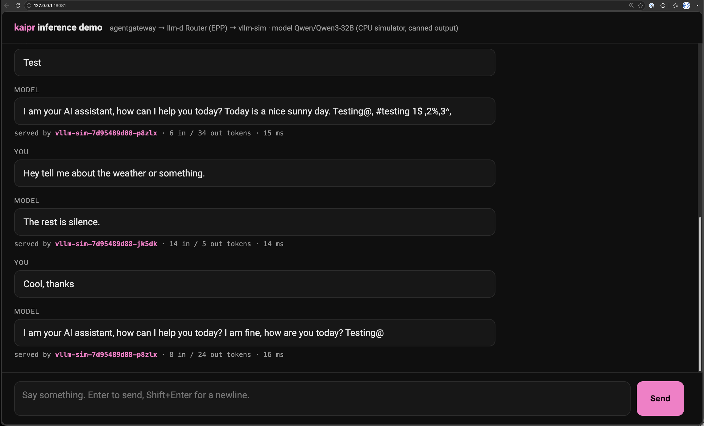

# quick start the demo

Only pre-requisites are Docker/Podman. Ensure you're at the cloned/forked repository root to run all commands. Will require two terminal sessions.

### Step 1: Bootstrap the local kaipr cluster
```
docker build -f bootstrap-rs/Dockerfile -t kaipr-toolbox:dev .
export TOOLBOX_IMAGE=kaipr-toolbox:dev
scripts/toolbox-run.sh bootstrap
```

### Step 2: Change your context and confirm kaipr node exists
```
export KUBECONFIG="$PWD/.kube/kaipr.yaml" && kubectl get nodes
```

### Step 3: If you see a kaipr node in the above output, run
```
mise -E local-host run inference-demo
```

#### The demo is now live at `http://127.0.0.1:18081`; it and the port-forward stays up until you Ctrl-C the terminal running or kill the processes.


