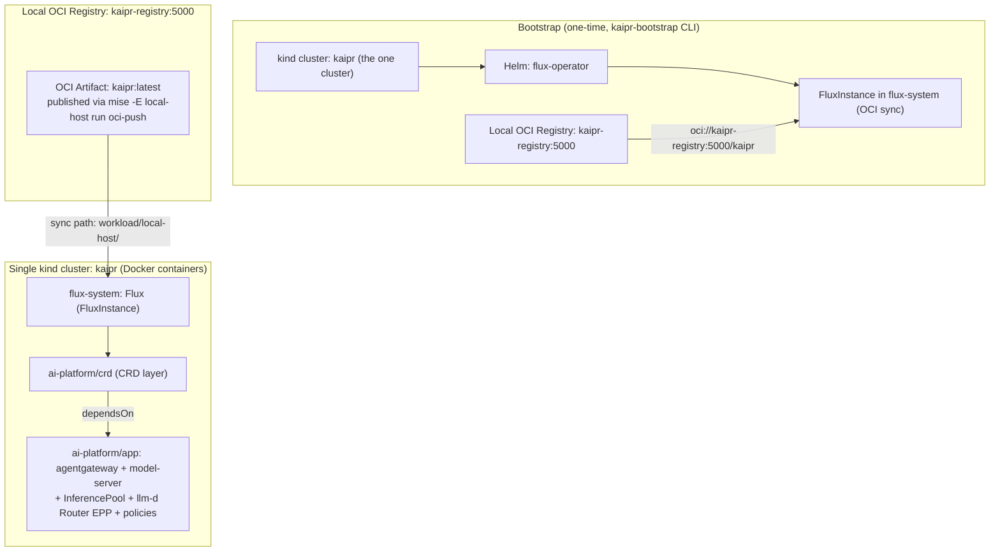

# Architecture

GitOps-driven [Flux](https://fluxcd.io/) platform, on a single host. One
[local](https://kind.sigs.k8s.io/) `kind` cluster (`kaipr`) runs the entire
platform - the Flux instance and the AI platform both live in it. A
one-time imperative bootstrap (`kaipr-bootstrap`) creates the cluster,
publishes this checkout to a local OCI registry, and seeds Flux with a
`FluxInstance` that syncs `workload/local-host/` from that artifact. After
the seed, Git is the source of truth and the bootstrap is done.

There is no management cluster, no [Cluster API](https://cluster-api.sigs.k8s.io/)
(CAPI/CAPD), no pivot, and no plaintext secrets: the stack reconciles
everything from the local registry artifact, and the repository carries no
credentials except SOPS-encrypted `*.sops.yaml` manifests under `workload/`
(the age private key never enters Git; see [Secret management](./secrets.md)).

The GitOps scaffolding (bootstrap engine, toolbox, and repository layout) is
derived from [krops](https://github.com/polarsquad/krops). krops ships
multiple cloud environments with a CAPI management plane; kaipr keeps the
scaffolding and scopes it to one environment, `local-host`, on a single
kind cluster, so the whole thing runs on a laptop with no cloud account.
The environment is declared in [`bootstrap.toml`](../bootstrap.toml), which
is the single source of truth for what environments exist.

The operator normally runs the imperative lifecycle through the
`kaipr-toolbox` container. It mounts the host engine socket, joins the kind
network while the bootstrap cluster exists, and leaves no toolbox workload
in the cluster. This packaging changes the host tool boundary, not the Flux
reconciliation architecture.

## The local-host environment

`local-host` replaces the cloud provider with a local Docker container
(kind) and replaces GitHub with a local in-memory OCI registry
(`kaipr-registry:5000`). It reconciles the `ai-platform` end to end on a
single host. No GitHub PAT, no cloud account, no GPU, and no plaintext
secrets: the tree carries credentials only as SOPS-encrypted `*.sops.yaml`
manifests under `workload/` (see [Secret management](./secrets.md)).



### Reconciliation order (local-host)

One cluster, seeded imperatively then reconciled from the OCI artifact:
```
kind create cluster kaipr
  -> registry container (kaipr-registry)
  -> publish workload/local-host/ as oci://kaipr-registry:5000/kaipr:latest
  -> helm flux-operator
  -> FluxInstance (flux-system, OCI sync, sync.path = workload/local-host)
  -> local-ai-platform-crd (CRD layer)
  -> local-ai-platform (app layer, dependsOn the CRD layer)
```

### How the cluster is populated

1. The bootstrap publishes the checkout's `workload/local-host/` to the
   local registry as the `kaipr:latest` OCI artifact (the path is preserved
   inside the artifact so the Flux `sync.path` keeps working).
2. It installs the Flux Operator (helm, pinned in `bootstrap.toml`) and
   applies a `FluxInstance` in `flux-system` that syncs `workload/local-host/`
   from that artifact.
3. The cluster's Flux reconciles `workload/local-host/`. The root
   Kustomization creates two Flux Kustomizations: the AI CRD layer
   (`ai-platform/crd/`) and the AI app layer (`ai-platform/app/`), the
   latter `dependsOn` the former so the CRDs exist before the AI objects
   are dry-run. See [Inference platform](./inference.md).
4. Inside the AI app layer, the components reconcile in this order: the
   `agentgateway` control plane, then the model server, the `InferencePool`
   + llm-d Router EPP, and the LLM policies that bind them together.

## The AI platform

The AI platform layer on the cluster (`ai-platform/crd/` for the CRD
prerequisites, `ai-platform/app/` for the components) is an example of an AI
inference platform built on [agentgateway](https://agentgateway.dev). The
request path:

```
Client
  -> inference-gateway Gateway (agentgateway data plane)
  -> HTTPRoute vllm-sim-llm  (matches /v1/chat/completions)
  -> AgentgatewayBackend vllm-sim   (LLM-aware: token counting, token budget)
  -> InferencePool vllm-sim         (groups the model-server pods by label)
  -> llm-d Router EPP               (picks one pod via ext-proc)
  -> model-server pod (vllm-sim)
```

The full component list, the pinned versions, the CRD prerequisites, bring-up
verification, and the vLLM overlay for a real model are in
[Inference platform](./inference.md).

## Extending

To add an application to the platform, see
[Extending the reference](./extending.md). The bootstrap engine
(`bootstrap-rs/`) is deliberately generic over environments; this reference
simply enables one of them in `bootstrap.toml`.
